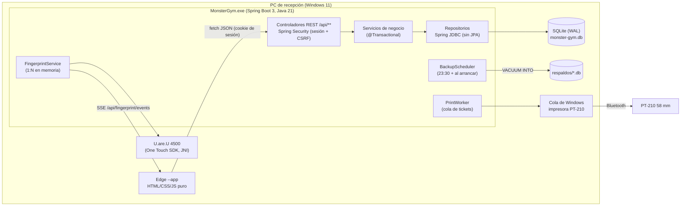
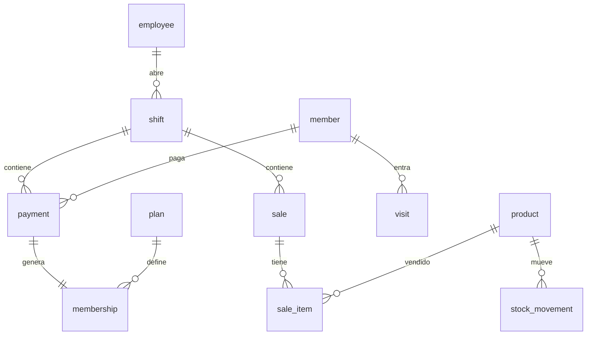

# Monster Gym POS

Sistema de recepción para un gimnasio: **socios y membresías, control de acceso con huella, caja con
turnos y corte, venta de refri (punto de venta), tickets en impresora térmica y respaldos**.

Corre **100 % local** en la PC de recepción (Windows 11), sin internet. Es un servidor Spring Boot
que sirve su propia página web; el personal la usa en una ventana de Edge en modo app.

| | |
|---|---|
| Estado | Fases 0–6 terminadas; Fase 7 (entrega) lista, pendiente de instalarse en la PC del gimnasio |
| Versión | 1.0.0 (`dist/MonsterGym-1.0.0.zip`) |
| Pruebas | ~200 pruebas de integración (JUnit + MockMvc sobre SQLite real) |
| Idioma | Todo en español: UI, mensajes de error, código de negocio, commits |

---

## Índice
1. [Cómo leer este proyecto](#1-cómo-leer-este-proyecto)
2. [Arranque rápido (desarrollo)](#2-arranque-rápido-desarrollo)
3. [Arquitectura](#3-arquitectura)
4. [Estructura del código](#4-estructura-del-código)
5. [Modelo de datos](#5-modelo-de-datos)
6. [Flujos principales](#6-flujos-principales)
7. [Frontend](#7-frontend)
8. [Hardware: huella e impresora](#8-hardware-huella-e-impresora)
9. [Configuración y perfiles](#9-configuración-y-perfiles)
10. [Seguridad y roles](#10-seguridad-y-roles)
11. [Respaldos](#11-respaldos)
12. [Pruebas](#12-pruebas)
13. [Empaquetar e instalar](#13-empaquetar-e-instalar)
14. [Decisiones de diseño (y por qué)](#14-decisiones-de-diseño-y-por-qué)
15. [Problemas conocidos y soluciones](#15-problemas-conocidos-y-soluciones)
16. [Cómo hacer cambios](#16-cómo-hacer-cambios)

---

## 1. Cómo leer este proyecto

Orden recomendado para entenderlo desde cero:

1. **Este README**: visión general y el porqué de las decisiones.
2. **`CLAUDE.md`**: reglas técnicas obligatorias (dinero en centavos, migraciones, frontend) y flujo de trabajo.
3. **`docs/reglas-negocio.md`**: la fuente de verdad del negocio (membresías, turnos, tickets, roles, respaldos).
   Si el código y este documento no coinciden, manda el documento, o se actualiza primero.
4. **`docs/modelo-datos.md`**: tablas, columnas y convenciones de SQLite.
5. **`docs/api.md`**: todos los endpoints, formatos, permisos y códigos de error.
6. **`docs/instalacion.md`**: cómo se arma el instalador y qué hace en la PC del gimnasio.

---

## 2. Arranque rápido (desarrollo)

### Requisitos (una vez por PC de desarrollo)
| Qué | Para qué |
|---|---|
| JDK 21 o superior (se usa 26) con `jpackage` | Compilar, correr y empaquetar |
| DigitalPersona **One Touch for Windows SDK 1.6.1** | Jars Java del lector + DLL nativas en `System32` |
| `tools\instalar-sdk-huella.bat` | Instala `dpotapi.jar` y `dpotjni.jar` en `~/.m2` (no están en Maven Central ni en el repo) |
| Impresora PT-210 emparejada como "PT-210" (Generic / Text Only) | Solo si se prueban tickets reales |

No hace falta instalar Maven: se usa el wrapper `mvnw.cmd`.

### Comandos (PowerShell)
```powershell
# Correr en desarrollo (datos de ejemplo, lector e impresora simulados)
.\mvnw.cmd spring-boot:run "-Dspring-boot.run.profiles=dev"

# Igual, pero con el lector y la impresora reales
$env:MONSTER_FINGERPRINT_MODE='real'; $env:MONSTER_PRINTER_MODE='real'; .\mvnw.cmd spring-boot:run "-Dspring-boot.run.profiles=dev"

# Pruebas
.\mvnw.cmd test

# Paquete instalable -> dist\MonsterGym-<versión>.zip
powershell -ExecutionPolicy Bypass -File tools\instalador\empaquetar.ps1 -Version 1.0.0
```
Abrir http://localhost:8080. En dev todos los empleados de ejemplo tienen PIN **1234**
(administrador: `sergio.ramirez`). La base de dev es `./monster-gym.db` (no se sube al repo).

> Solo un programa a la vez puede usar el lector de huella y el puerto 8080: si está corriendo la versión
> instalada (`C:\MonsterGym`), la app de desarrollo no arranca bien.

---

## 3. Arquitectura



**Ideas clave**
- **Monolito local**: un solo proceso Java sirve la API y los archivos estáticos. Sin servicios externos.
- **SQLite + Flyway**: una sola conexión (Hikari con pool de 1) en modo WAL; las migraciones se aplican al arrancar.
- **Capas**: `Controller` (valida entrada con Bean Validation y permisos con `@PreAuthorize`) →
  `Service` (reglas de negocio, transacciones) → `Repository` (SQL a mano con `JdbcTemplate`).
- **Errores**: `ApiException(status, code, mensaje)` → `GlobalExceptionHandler` responde siempre
  `{ "error": { "code", "message", "fields"? } }` con mensaje en español.
- **Hardware detrás de interfaces**: `FingerprintReader` (real / simulado) y `TicketPrinter` (real / simulado);
  se elige con `app.fingerprint.mode` y `app.printer.mode`. Si el hardware falla, la app sigue funcionando.
- **Tiempo**: un `Clock` inyectable con zona `America/Mexico_City` (las pruebas pueden fijar la fecha).

---

## 4. Estructura del código

```
src/main/java/com/monstergym/
├── MonsterGymApplication.java   # main; zona horaria; @EnableScheduling
├── auth/        # login con PIN (BCrypt), bloqueo tras 5 intentos, /api/me, primer arranque (/api/setup)
├── employee/    # Admin > Empleados (alta, edición, desactivar, cambio de PIN)
├── shift/       # turnos: apertura con fondo, cierre con efectivo contado, resumen del corte
├── member/      # socios: alta (con cobro opcional), búsqueda sin acentos, detalle, baja lógica
├── plan/        # 4 planes fijos; solo se edita el precio
├── payment/     # cobro de membresía (crea payment + membership), cancelación con motivo
├── visit/       # entradas (manual o huella), aforo "dentro ahora", doble registro
├── product/     # refri: inventario, reabasto, mermas y ajustes (stock_movement)
├── sale/        # venta en una transacción (valida stock), cancelación
├── dashboard/   # pantalla de Inicio
├── report/      # ingresos por mes, resumen (Admin > Reportes)
├── setting/     # configuración clave/valor (tabla setting)
├── printing/    # tickets ESC/POS: render, cola (print_job), worker, transporte a Windows
├── fingerprint/ # lector: interfaz, DigitalPersona real, simulado, identificación 1:N, enrolamiento, SSE
├── backup/      # respaldo diario, descarga y restauración
├── config/      # seguridad, CSRF, DataSource SQLite, interceptor de empleado activo, reloj
└── common/      # ApiException, manejo global de errores, normalización de texto para búsqueda

src/main/resources/
├── application.properties        # base (producción por defecto: hardware real)
├── application-dev.properties    # dev: datos de ejemplo + hardware simulado
├── application-prod.properties   # instalado: datos en C:\MonsterGym\datos, solo 127.0.0.1, log a archivo
├── db/migration/V1..V6           # esquema (todas las PCs)
├── db/dev/V2__seed_dev.sql       # datos de ejemplo (solo dev)
└── static/                       # index.html, css/styles.css, js/{api.js, app.js, data.js}

tools/
├── instalador/        # empaquetar.ps1, INSTALAR.bat, instalar.ps1, abrir.ps1, desinstalar.ps1, LEEME.txt, ícono
├── instalar-sdk-huella.bat
└── fp-spike/          # prueba aislada del SDK de huella (Fase 6A); no corre junto con la app
docs/                  # reglas de negocio, modelo de datos, API, instalación
```

---

## 5. Modelo de datos

Detalle completo en `docs/modelo-datos.md`. Convenciones: **dinero en centavos (INTEGER)**, fechas ISO 8601 en
hora local de México, booleanos 0/1 con CHECK, valores cerrados con `CHECK (col IN (...))`.



| Tabla | Para qué |
|---|---|
| `employee` | Usuarios: rol (`administrador`, `recepcion`, `entrenador`), PIN en BCrypt, bloqueo, `active` |
| `member` | Socios: número de 4 dígitos, `search_key` sin acentos, plantilla de huella (BLOB), `active` (baja lógica) |
| `plan` | Semanal 7 d, Quincenal 15 d, Mensual 30 d, Anual 365 d (V3) |
| `payment` / `membership` | Cada cobro crea un pago (precio del momento) y un periodo `starts_on`–`ends_on`. Nunca se borran: se cancelan (`voided_at`) |
| `shift` | Turno: fondo inicial, efectivo contado, notas. Índice único: un turno abierto por empleado |
| `visit` | Entradas con método (`huella`/`manual`) y estado del socio en ese momento |
| `product`, `sale`, `sale_item`, `stock_movement` | Refri e inventario |
| `print_job` | Cola de tickets con estado (`pendiente`, `entregado`, `en_cola_windows`, `fallido`...) |
| `setting` | Configuración editable desde Admin (nombre, aforo, días de aviso, impresora, lector...) |
| `v_member_status` (vista) | **Estado de membresía calculado**: `activa`, `por_vencer`, `vencida`. Nunca se guarda |

---

## 6. Flujos principales

**Turno.** Al entrar, Recepción y Administrador abren turno con un fondo inicial (el Administrador puede
"Entrar sin abrir turno" para tareas de administración). Todo cobro y venta se liga al turno abierto.
Al cerrar se captura el efectivo contado; el sistema muestra el esperado y la diferencia, imprime el corte y
cierra la sesión. Un turno cerrado no se modifica.

**Cobro de membresía** (`PaymentService.charge`, en una transacción): valida socio activo, plan y turno abierto →
calcula el periodo (`MembershipPeriod`: si sigue vigente empieza al día siguiente del vencimiento; si no, hoy) →
inserta `payment` + `membership` → al confirmar, **encola** el ticket. La respuesta no espera a la impresora.

**Acceso.** Manual: se busca al socio, y si está vencido se pide confirmación (alerta roja); si entró hace menos de
5 minutos se pide confirmar el doble registro. Por huella: el lector captura → `FingerprintService` compara contra
las plantillas en memoria (el SDK solo compara 1 a 1; se recorre la lista, primero los que vienen seguido) →
registra la visita a nombre de quien atiende → avisa por SSE a la pantalla.

**Refri.** La venta es una transacción: valida stock, descuenta inventario, guarda el precio unitario del momento.
Dos ventas simultáneas del último producto: solo una procede.

**Impresión.** `PrintService` inserta en `print_job` y despierta a `PrintWorker` (un hilo, en orden, con timeout y
reintentos). **Una falla de impresión nunca revierte un cobro ni un cierre.** Se puede reimprimir (marcado "COPIA").

**Primer arranque.** Si no hay ningún administrador activo, la pantalla de login muestra "Crea el administrador"
(`/api/setup`). Solo funciona mientras no exista ninguno.

---

## 7. Frontend

HTML/CSS/JS puro en `src/main/resources/static`, sin framework ni build.

- `index.html`: todas las pantallas (`data-screen`: inicio, acceso, socios, nuevo, caja, pos, visitas, cierre,
  admin) y las "compuertas" (`data-gate`: login, apertura de turno).
- `js/api.js`: cliente `window.API` (fetch con cookie de sesión y cabecera `X-XSRF-TOKEN`; errores como `ApiError`).
- `js/app.js`: navegación (`go(screen)`), carga de cada pantalla (`load*`) y dibujo (`render*`, reciben los datos).
- `js/data.js`: restos del prototipo con datos fijos; se fue reemplazando por la API.

Reglas (de `CLAUDE.md`): **no cambiar clases CSS ni la estructura del HTML existente** (solo agregar ids,
`data-*` o elementos nuevos con clases existentes); el dinero llega en centavos y se convierte al mostrar
(`money(pesos(cents))`). Ojo: `.btn` y `.login__form` definen `display`, así que el atributo `hidden` no los
oculta; usar `style.display`.

---

## 8. Hardware: huella e impresora

### Lector de huella DigitalPersona U.are.U 4500
- SDK: **One Touch for Windows 1.6.1** (Java: `com.digitalpersona.onetouch.*`, JNI a DLL en `System32`).
- El SDK **solo verifica 1:1**; la identificación 1:N es un ciclo en memoria (~1 ms por comparación).
- Plantilla = `DPFPTemplate.serialize()`: bytes propietarios, guardados en `member.fingerprint_template`.
- Captura con **prioridad baja** (funciona sin ventana), pero **un solo programa a la vez** puede usarla.
- Enrolamiento: 4 muestras; el progreso llega por SSE. Si el lector se desconecta, la app sigue con acceso manual.
- En la PC del gimnasio basta el **RTE** (runtime), que el instalador incluye e instala si falta.

### Impresora térmica GOOJPRT PT-210 (58 mm, Bluetooth)
- Se usa **solo por la cola de Windows** (impresora "PT-210", controlador *Generic / Text Only*, bytes ESC/POS crudos).
  El puerto COM directo se descartó: acepta datos aunque la impresora esté apagada.
- **Sin acentos**: la PT-210 se queda en modo chino e ignora `FS .`; todo byte ≥ 0x80 sale como carácter chino.
  Por eso `printer_charset = US-ASCII` y el texto se translitera (Ñúñez → Nunez).
- 32 columnas, sin cortador ni cajón; cada ticket termina con 4 saltos de línea.
- Windows no sabe si está encendida: el estado "en_cola_windows" significa "entregado a Windows".

---

## 9. Configuración y perfiles

| Perfil | Cuándo | Datos | Hardware |
|---|---|---|---|
| *(ninguno)* | — | `./monster-gym.db` | real |
| `dev` | desarrollo | `./monster-gym.db` + datos de ejemplo (V2) | simulado (se puede forzar real) |
| `prod` | instalado con el zip | `C:\MonsterGym\datos` | real; solo escucha en `127.0.0.1` |

| Variable de entorno | Default | Uso |
|---|---|---|
| `MONSTER_DATA_DIR` | `C:/MonsterGym/datos` (prod) | Carpeta de base, respaldos y logs |
| `MONSTER_BACKUP_DIR` | `<datos>/respaldos` | Mover respaldos a USB u OneDrive |
| `MONSTER_BACKUP_KEEP_DAYS` | 30 | Respaldos diarios a conservar |
| `MONSTER_BACKUP_CRON` | `0 30 23 * * *` | Hora del respaldo diario |
| `MONSTER_PRINTER_MODE` | `real` (`fake` en dev) | `fake` guarda tickets en `tickets-dev/` |
| `MONSTER_FINGERPRINT_MODE` | `real` (`fake` en dev) | `fake` = lector simulado (`/api/fingerprint/fake/*`) |
| `MONSTER_ADMIN_USERNAME`, `MONSTER_ADMIN_PIN`, `MONSTER_ADMIN_NAME` | vacío | Alternativa a la pantalla de primer arranque |

El resto de la configuración vive en la tabla `setting` y se edita en Admin > Configuración.

---

## 10. Seguridad y roles

- Login con usuario + PIN/contraseña (BCrypt). 5 intentos fallidos = bloqueo temporal.
- Sesión por cookie HttpOnly (12 h) + CSRF con cookie `XSRF-TOKEN` / cabecera `X-XSRF-TOKEN`.
- Un empleado desactivado pierde la sesión en su siguiente petición (`ActiveEmployeeInterceptor`).
- Cada endpoint valida rol con `@PreAuthorize`. Resumen:

| Acción | Admin | Recepción | Entrenador |
|---|---|---|---|
| Ver inicio, consultar socios y visitas | ✓ | ✓ | ✓ |
| Registrar entradas, crear/editar socios, cobrar, vender, abrir/cerrar su turno | ✓ | ✓ | — |
| Cancelar pagos o ventas, ver todos los cortes, Admin (empleados, precios, config, reportes) | ✓ | — | — |
| Dar de baja socios, respaldos y restauración | ✓ | — | — |

Tabla completa en `docs/reglas-negocio.md` > Roles y permisos.

---

## 11. Respaldos

- **Automático**: todos los días a las 23:30 y al arrancar si ese día no hay uno (`VACUUM INTO`, copia consistente
  con la app en uso). Archivo `monster-gym-AAAA-MM-DD.db`; se conservan 30.
- **Admin > Respaldos**: respaldar ahora, descargar, restaurar.
- **Restaurar** reemplaza todos los datos: solo Administrador, sin turnos abiertos, escribiendo `RESTAURAR`.
  Valida que sea una base sana de Monster Gym y no de una versión más nueva; guarda antes la base actual
  (`antes-de-restaurar-*.db`); usa la API de backup de SQLite sobre la conexión viva (`restore from`), aplica
  migraciones si el respaldo es viejo y recarga las huellas. Si algo falla, regresa a la base anterior.
- Los respaldos están en el mismo disco: conviene copiar uno a USB/nube cada semana.

---

## 12. Pruebas

`.\mvnw.cmd test`. Casi todas son de integración (`ApiTestBase`): contexto Spring completo, MockMvc y una base
SQLite temporal en `target/`, con impresora y lector simulados. Cada prueba reinicia los datos (empleados `admin`,
`recepcion`, `entrenador`, `inactiva` con PIN 1234 y los 4 planes). `ProdProfileTest` verifica el perfil prod.

Regla del proyecto: **cada cambio de lógica de negocio lleva pruebas**.

---

## 13. Empaquetar e instalar

```powershell
powershell -ExecutionPolicy Bypass -File tools\instalador\empaquetar.ps1 -Version 1.0.1
```
Genera `dist\MonsterGym-<versión>.zip` (~90 MB): `MonsterGym.exe` con Java incluido (jpackage, sin WiX),
el RTE del lector y los scripts. En la PC del gimnasio: descomprimir → `INSTALAR.bat`.

```
C:\MonsterGym\programa   # se reemplaza al actualizar
C:\MonsterGym\datos      # monster-gym.db, respaldos\, logs\  (nunca se toca)
```
El instalador registra una **tarea programada al iniciar sesión** (sin ventana) y crea el acceso directo
"Monster Gym" (`abrir.ps1`: arranca el servidor si hace falta y abre Edge en modo app).
Actualizar = generar un zip con versión nueva y volver a correr `INSTALAR.bat`. Ver `docs/instalacion.md`.

El zip **no se sube al repositorio** (contiene el RTE de DigitalPersona); si se publica, que sea en un Release privado.

---

## 14. Decisiones de diseño (y por qué)

| Decisión | Motivo |
|---|---|
| Spring JDBC sin JPA | SQL explícito, simple de seguir; SQLite y consultas a la medida (vista de estado, búsqueda) |
| SQLite con pool de 1 conexión | Una sola PC; evita bloqueos de escritura; WAL para lecturas concurrentes |
| Estado de membresía calculado (vista) | Nunca se desincroniza; depende de la fecha de hoy y de `warn_days` |
| Pagos y socios nunca se borran | Los cortes cerrados y los reportes deben cuadrar siempre (cancelación / baja lógica) |
| Impresión asíncrona con cola | La PT-210 por Bluetooth es lenta e intermitente; el cobro no puede esperarla ni fallar por ella |
| Identificación 1:N en memoria | El SDK solo hace 1:1; con cientos de socios tarda milisegundos |
| SSE para eventos de huella | El servidor empuja al navegador sin websockets ni librerías |
| Frontend sin framework | Partió de un prototipo HTML; sin build ni dependencias |
| jpackage + tarea al iniciar sesión (no Tauri, no servicio) | Tauri añadía Rust y un proceso extra; un servicio corre en la sesión 0, donde el lector y la impresora del usuario pueden no funcionar |
| Primer administrador desde la app | Instalar en otra PC sin configurar variables ni guardar PINs en claro |
| Solo `127.0.0.1` en producción | Nadie de la red accede a la caja; sin aviso del firewall |

---

## 15. Problemas conocidos y soluciones

| Síntoma | Causa / solución |
|---|---|
| `mvn` no se reconoce | Usar `.\mvnw.cmd` (Maven Wrapper) |
| La app de dev no arranca o el lector no responde | Está corriendo la versión instalada o `tools/fp-spike`: cerrarla (puerto 8080 y lector son exclusivos) |
| Ticket con caracteres chinos | Algún texto con acento con charset distinto de US-ASCII (ver sección 8) |
| Ticket "en_cola_windows" pero no sale papel | La impresora está apagada o fuera de alcance; Windows lo suelta al encenderla |
| No se puede restaurar un respaldo | Hay un turno abierto: cerrarlo (el Administrador puede entrar sin abrir turno) |
| "Monster Gym no arrancó" (instalado) | Ver el log más reciente en `C:\MonsterGym\datos\logs` |
| Error de compilación por `com.digitalpersona` | Faltan los jars del SDK en `~/.m2`: correr `tools\instalar-sdk-huella.bat` |

Pendientes conocidos (decididos por el dueño): el precio del plan Anual es provisional (se cambia en Admin >
Precios) y el consentimiento de huella todavía no se pide (`fingerprint_consent_at` vacío).

---

## 16. Cómo hacer cambios

Resumen de `CLAUDE.md`:
- Leer `docs/` antes de trabajar; si una petición contradice los documentos, avisar antes.
- Cambios grandes: proponer un plan breve y esperar aprobación.
- **Nunca editar una migración aplicada**: crear `V7__...sql`, etc.
- Dinero en centavos, fechas ISO, zona `America/Mexico_City`, textos en español.
- Todo endpoint valida entrada y rol; cada cambio de negocio lleva pruebas.
- Un commit por paso, en español. Antes de terminar: pruebas + correr la app + decir cómo verificar.
- Al cambiar una regla de negocio, actualizar primero `docs/reglas-negocio.md` (y `docs/api.md` si cambia la API).
